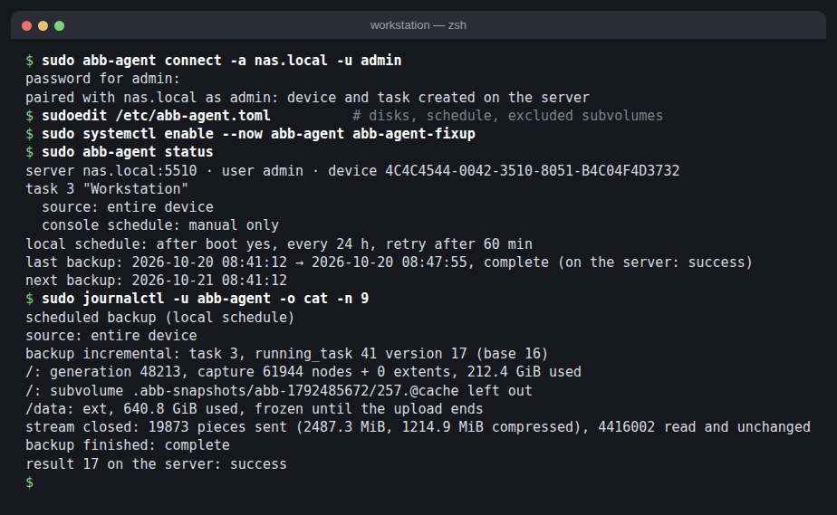
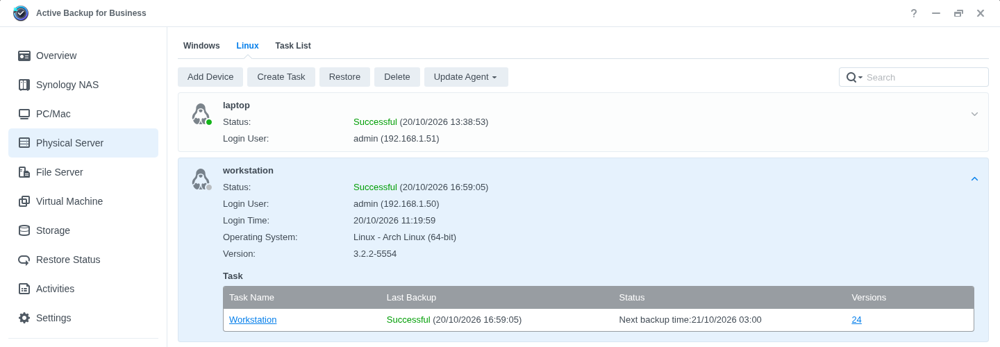
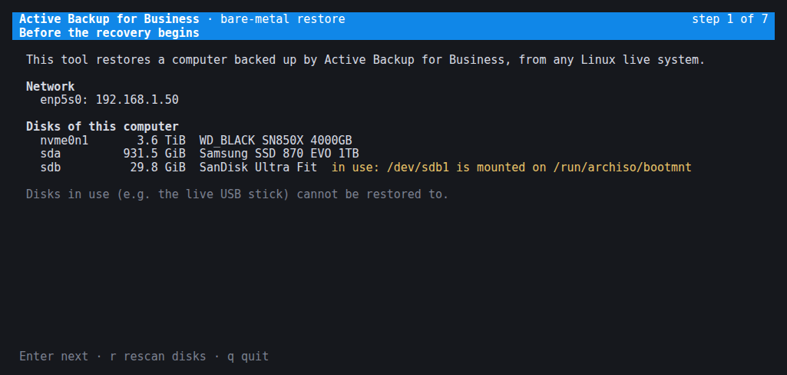
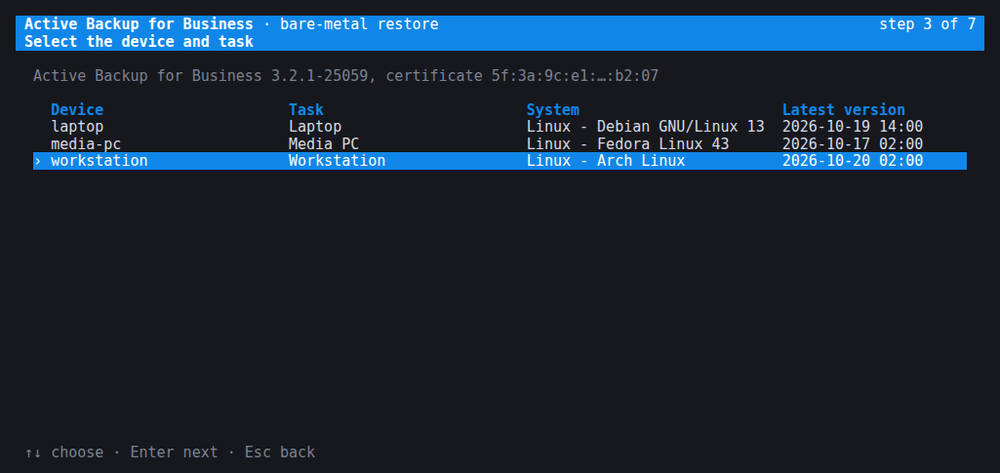
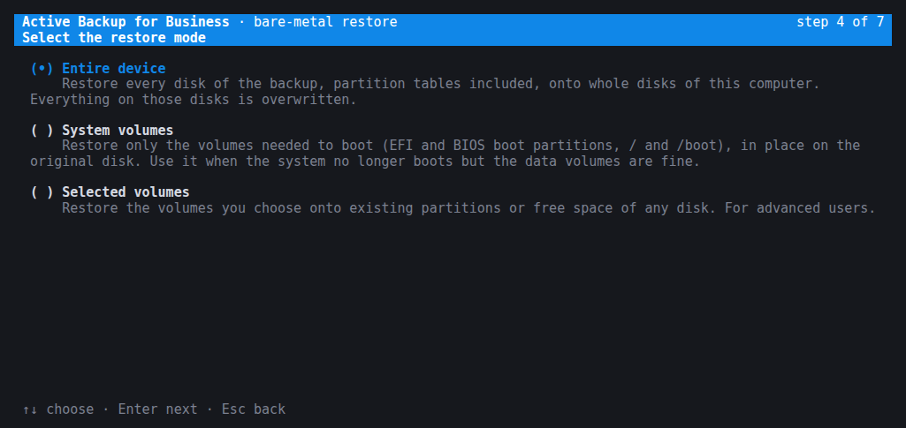
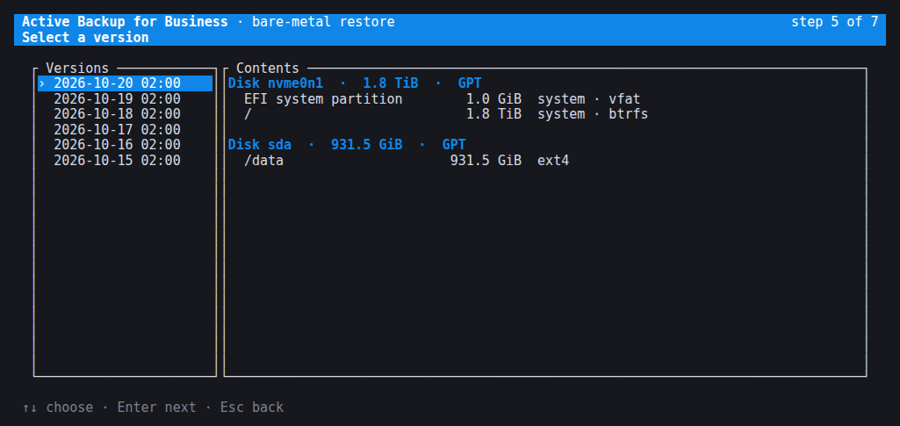
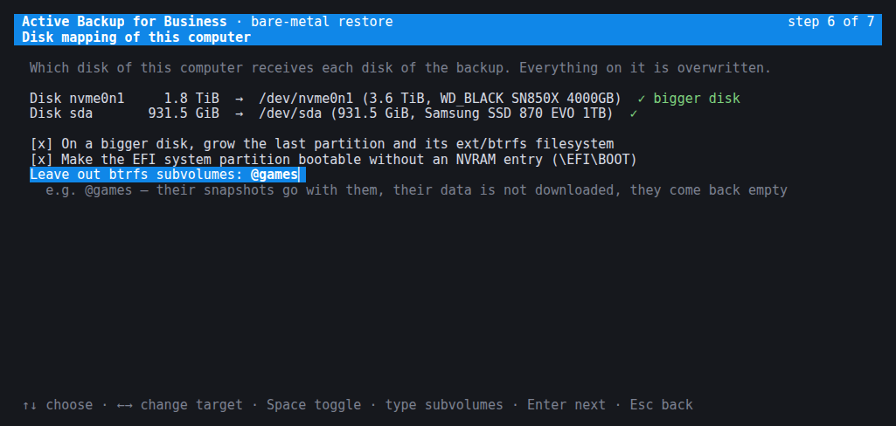
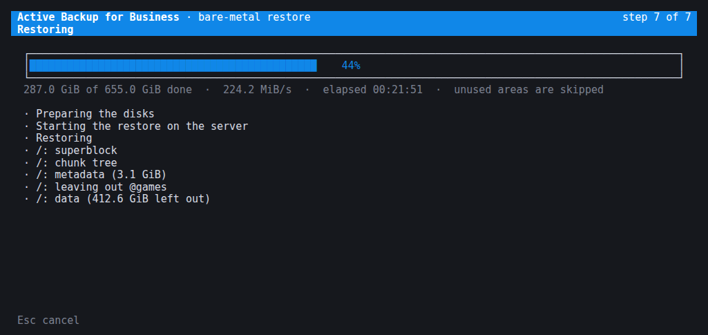

# abb-agent

<h3 align="center">
An Active Backup for Business agent that runs on any Linux distribution and any kernel, 7.x
included: written in Rust, no kernel module to build, nothing to break on the next update.<br>
The way it should have been from the start.
</h3>

A Linux agent for **Synology Active Backup for Business** (ABB) that makes full-disk image
backups of machines whose root filesystem is **btrfs**, and also of ext2/3/4 volumes. It talks to an
unmodified ABB server: the device shows up in the ABB console like any other physical
server, backups are versioned, deduplicated and restorable with Synology's tools.

Written in **Rust**: one self-contained binary, memory-safe by design. It needs
no kernel module and no Synology binaries.

## Supported filesystems

> ### 🟢 btrfs: first-class support
> The filesystem the official agent cannot back up. abb-agent reads btrfs natively: read-only
> snapshots of every subvolume, only the blocks in use, every data block verified against the
> btrfs checksums, incremental backups from btrfs metadata, subvolumes that can be left out.

| filesystem | backup | incremental | notes |
|---|---|---|---|
| **btrfs** | ✅ | ✅ | single device, any subvolume layout (`@`, `@home`, snapper, btrbk…) |
| **ext4** | ✅ | ✅ | mounted read-write too, the root filesystem included: frozen for an instant to capture the metadata |
| **ext3**, **ext2** | ✅ | ✅ | as ext4 |
| vfat (EFI system partition), BIOS boot | ✅ | ✅ | copied as they are; a mounted ESP that changes while read makes the backup partial |
| XFS, LVM, LUKS, md-raid, multi-device btrfs | ❌ | | left out, the backup is reported as partial |

Disks must use GPT partition tables.

> **Status: experimental.** Backups and incremental backups work and have been verified
> by checking the images stored on the server (`btrfs check`, scrub, `e2fsck`, file
> comparison) and by booting them; bare-metal restores with `abb-restore` and with Synology's
> recovery media boot. Do not use it as your only backup yet.

This project is not affiliated with, endorsed or supported by Synology Inc. "Synology" and
"Active Backup for Business" are trademarks of Synology Inc.

## Quick start



1. **On the NAS**: install *Active Backup for Business* from the Package Center. In ABB →
   *Settings* → *Template*, check that the default template points to an existing shared folder
   (new devices take their destination from it). Use a DSM account allowed to use ABB.
2. **Install** abb-agent. On Arch Linux, from the AUR:

   ```sh
   yay -S abb-agent-bin      # prebuilt; or `abb-agent` to build it from source
   ```

   On other distributions see [Install](#install).
3. **Connect** the machine to the NAS (the password is asked, a two-factor code too if enabled):

   ```sh
   sudo abb-agent connect -a nas.local -u admin
   ```

   The device and its backup task appear in the ABB console. Rename the task or set its
   retention there if you like.
4. **Configure** `/etc/abb-agent.toml`. As installed every setting is a comment: uncomment at least
   the disks to back up, e.g. `disks = ["system"]`, and the schedule you want. Each setting stays
   under its `[section]` line.
5. **Start** the service. The first backup runs right away (after every boot by default), the
   following ones are incremental:

   ```sh
   sudo systemctl enable --now abb-agent abb-agent-fixup
   sudo abb-agent status
   ```

To **restore** a whole machine, boot any Linux live USB, download `abb-restore` from the
[latest release](https://github.com/rylos/abb-agent/releases/latest) and run `sudo ./abb-restore`
(see [Restore](#restore)).

## Screenshots

The machine in the ABB console, as any other physical server:



`abb-restore`, the bare-metal restore for live systems:

| | |
|---|---|
|  |  |
|  |  |
|  |  |

## Why

The official Linux agent relies on a kernel module (`synosnap`) that tracks block writes.
On btrfs that approach does not work, and the module has to be rebuilt for every kernel.
abb-agent takes a different route: btrfs already knows which blocks are in use and
keeps checksums of them, so a consistent image can be produced from the raw device with
read-only snapshots and a bit of care.

## Features

- Whole-disk images: GPT, EFI system partition, BIOS boot partition and every volume, so a
  restored disk has the same partitions, UUIDs and boot loader.
- **btrfs**: read-only snapshots of all subvolumes, then only the blocks in use at that
  transaction are sent. Every data block is verified against the btrfs checksum tree before it
  leaves the machine. Snapshots are removed when the backup ends.
- **Incremental backups** (changed-block tracking) computed from btrfs metadata, without
  reading the data again. In-place writes such as NOCOW files and preallocated extents are
  detected too.
- **Subvolume exclusion**: btrfs subvolumes (e.g. a games library or a package cache) can be
  left out of the image. In the image they become deleted subvolumes that btrfs removes on the
  first mount, so the restored filesystem stays consistent; their data is not sent. A small boot
  unit recreates them empty after a restore, so mounts in `/etc/fstab` keep working.
- **ext2/3/4**, mounted or not, root filesystem included: used blocks from the block-group
  bitmaps. A volume mounted read-write is frozen for an instant (typically well under a second)
  while its metadata (bitmaps, inode tables, directories, extent trees) is read into memory, then
  thawed; file data is read with the system running. The image is always a consistent
  filesystem; only files written during the backup may have mixed content (the same guarantee as
  file-level tools like rustic or restic), and the log counts them. `freeze_mounted = true`
  keeps the volume frozen for the whole upload instead. Incrementals read only what may have
  changed: the inode tables are compared with the previous backup's (ctime, mtime, size,
  generation, as rustic and restic do for files), and the blocks of unchanged files are not read
  again.
- Schedule decided by the agent: after every boot and every N hours, with retries. Backups
  can also be started from the ABB console.
- Parallel read, verification and LZ4 compression (several GB/s on NVMe).
- Mutual exclusion with other backup jobs through lock files.

See [Supported filesystems](#supported-filesystems) for what is left out.

## Requirements

- Linux with btrfs and/or ext4, GPT disks, x86_64 or aarch64.
- A Synology NAS with Active Backup for Business (tested with ABB 3.2.1 on DSM 7.4), and a DSM
  account allowed to use ABB.
- Root privileges on the client: the agent reads block devices and creates snapshots.

## Install

### Arch Linux

From the AUR, with any AUR helper:

| package | |
|---|---|
| [`abb-agent-bin`](https://aur.archlinux.org/packages/abb-agent-bin) | the release binaries, installs in seconds |
| [`abb-agent`](https://aur.archlinux.org/packages/abb-agent) | built from the release source |

```sh
yay -S abb-agent-bin
```

Or download the package from the [latest release](https://github.com/rylos/abb-agent/releases/latest)
and install it:

```sh
sudo pacman -U ./abb-agent-<version>-x86_64.pkg.tar.zst
```

It contains `abb-agent`, `abb-restore` and the systemd units. Nothing runs until you set it up
(see [Usage](#usage)). To build it yourself, use `packaging/arch/abb-agent` (release) or
`packaging/arch/abb-agent-git` (latest commit) with `makepkg -si`.

### Other distributions

From source (Rust 1.88 or newer):

```sh
cargo build --release -p abb-agent -p abb-restore
sudo install -Dm755 target/release/abb-agent /usr/bin/abb-agent
sudo install -Dm755 target/release/abb-restore /usr/bin/abb-restore
sudo install -Dm644 packaging/systemd/abb-agent.service /usr/lib/systemd/system/abb-agent.service
sudo install -Dm644 packaging/systemd/abb-agent-fixup.service /usr/lib/systemd/system/abb-agent-fixup.service
sudo install -Dm644 packaging/systemd/abb-agent.tmpfiles /usr/lib/tmpfiles.d/abb-agent.conf
sudo install -Dm644 packaging/abb-agent.toml /etc/abb-agent.toml
```

### Verifying a release

Tags and release files are signed with the release key
`B903 BF2C D82C 9EA4 5C9F  B35D E2E8 944F 0967 6A61` (Marco Ziliani (rylos)), also in
[`packaging/release-key.asc`](packaging/release-key.asc) and on GitHub:

```sh
curl -s https://github.com/rylos.gpg | gpg --import
gpg --verify abb-restore-<version>-x86_64.asc abb-restore-<version>-x86_64
git tag -v v<version>
```

### abb-restore for a live system

Each release also has `abb-restore-<version>-x86_64`, a static binary with no dependencies: copy it
onto a USB stick next to any live image. To build it:

```sh
rustup target add x86_64-unknown-linux-musl
cargo build --release --target x86_64-unknown-linux-musl -p abb-restore
```

`packaging/release.sh` builds all the release files into `dist/`.

## Usage

1. Connect the machine to the server. This creates the device and its backup task in ABB, using
   the server's default template:

   ```sh
   sudo abb-agent connect -a nas.example.lan -u backupuser
   ```

   The password is asked interactively, or read from `ABB_PASSWORD`. The server
   certificate is pinned on first contact.

2. Edit `/etc/abb-agent.toml`. As installed every setting is a comment, so each has its
   default (all internal disks, a backup after every boot): uncomment what you want, at least the
   disks (e.g. `disks = ["system"]`), and leave each setting under its `[section]` line.

3. Start the service:

   ```sh
   sudo systemctl enable --now abb-agent
   sudo systemctl enable abb-agent-fixup   # only needed if you exclude subvolumes
   ```

### Troubleshooting

| message | what to do |
|---|---|
| `server error 0x1005: Requires OTP` | the account has two-factor authentication: enter the code when asked, or pass `--otp <code>` |
| `server error 0x100f: Create Task Failed due to invalid parameters` | the default template's destination does not exist: fix it in ABB → *Settings* → *Template*, then connect again |
| `permission denied: run it with sudo` | the agent's state is readable by root only |
| `the NAS refuses this agent as too old` (status: *Refused*) | an Active Backup update raised the minimum agent build: update abb-agent; until a release is out, set `announce_build` in `[agent]` of `/etc/abb-agent.toml` to the build of the official agent the NAS offers (shown by `abb-agent status`) and restart the service. Once abb-agent announces a newer build itself, the setting is ignored (with a warning in the journal): remove it |
| `the abb-agent service is running: stop it first` | `abb-agent connect` writes the agent state the service uses: `sudo systemctl stop abb-agent`, pair, then start it again |
| `the NAS no longer knows this device` | the device was removed in the ABB console: pair again with `abb-agent connect` |
| backup ends with `partial` | a volume could not be backed up (unsupported filesystem…): see `journalctl -u abb-agent` |

Other commands:

| command | |
|---|---|
| `abb-agent status [-w]` | connection, tasks, last backup and next scheduled one; `-w` follows a running backup with a live progress bar until it ends |
| `abb-agent backup [-v]` | run a backup now, in the foreground: steps and a progress bar on a terminal, the detailed log in the journal (`journalctl -t abb-agent`); `-v` prints the log instead |
| `abb-agent config` | show the configuration in effect |
| `abb-agent cleanup` | delete the snapshots left by an interrupted backup (the service does it when it starts) |
| `abb-agent disks [disk]` | disks, partitions and filesystems as the agent sees them |
| `abb-agent bench [disk] [--limit GiB]` | everything a full backup does except sending, to measure speed |
| `abb-agent probe <server>` | the NAS's certificate and Active Backup version, without pairing |
| `abb-agent version` | the agent's version |

An option a command does not take is refused (exit status 2), so that a typo cannot start a
real backup. `abb-agent backup` stops cleanly (snapshots removed, filesystems thawed, the
server told) on Ctrl-C, on `kill` and when its terminal is closed.

### What the ABB console controls

The task settings in the ABB console apply as they do with the official agent:

| console setting | behaviour |
|---|---|
| Source type | *Entire device*: every internal disk. *System volume*: the volumes holding `/` and `/boot` plus the EFI/BIOS boot partitions. *Custom volume*: the volumes picked in the console (btrfs volumes are offered too). Partition tables are always kept, so the disks can be restored bare-metal with all their partitions; volumes left out are restored empty. |
| Schedule and backup window | followed in server time; a run missed while the machine was off happens when it comes back; a backup still running when the window closes is cancelled. On the nights the clocks change, a start in the skipped hour (02:30 in spring) runs once when the clocks jump, at 03:00 summer time, and one in the repeated hour runs once, the first time. Until the agent has had the NAS's time zone once, it does not follow the console schedule |
| Bandwidth limit | applied to the upload, also when changed during a backup |
| Transfer compression and encryption | followed: LZ4 blocks or raw ones, TLS or plaintext data connection (on a fast LAN, turning both off leaves more of the NAS CPU for the backup) |
| Pre/post scripts | the pre script runs before the snapshots, the post script right after them, as root with `/bin/sh` (180 s limit); output and result are reported to the server |
| Back up now / Cancel | start and stop a backup at any time |
| Retention, permissions, backup verification | handled by the server |

On top of that, `/etc/abb-agent.toml` can add a backup after every boot (on by default), a fixed
interval (counted from the start of the last backup, failed ones too, or from the first start of
the service), retries after a failure, lock files to wait for, a condition for the agent's own
backups (`only_if`, e.g. a laptop only on the home network), and commands to run when a backup
starts and ends (e.g. to ping a monitoring service). Disks can be named by stable paths
(`/dev/disk/by-id/…`) or as `system`, and each disk keeps its image on the server even if the
kernel names it differently later.

## Restore

The server stores one image per disk. Files can be browsed and restored from the ABB portal.

### Files from the ABB portal

In the portal, pick a version, select files or folders and either **Download** them or
**Restore** them onto the device, to their original place or to another folder. A restore onto
the device is carried out by the running agent: files are written next to their destination
under a temporary name and renamed into place, with owner, permissions and times; folders get
theirs once their content is written. *Skip* keeps whatever already exists, otherwise it is
replaced. Missing parent folders are created. Progress and the outcome of each file appear in the
portal; a restore can be cancelled there.

What the server sends limits what comes back:

- **Symbolic links, FIFOs, sockets and device files are not restored**: the server sends only
  regular files and folders, and lists the others as not supported (the restore is then
  *partial*). The bare-metal restore below brings back everything.
- **Hard links** come back as separate copies of the file.
- **Sparse files** stay sparse: blocks of zeros are not written.
- Extended attributes and ACLs are not restored.

### Bare-metal restore with abb-restore

`abb-restore` is a single static binary (no dependencies) that restores a whole machine from any
Linux live system: Arch ISO, SystemRescue, Ubuntu live, anything with a network and a shell.

```sh
# on the live system, as root
./abb-restore
```

A text interface walks through the same steps as Synology's recovery wizard: NAS address and
account, device and task, restore mode, version, disk mapping, summary and progress.

| mode | what it does |
|---|---|
| Entire device | every disk of the backup onto a whole local disk, partition table included |
| System volumes | only the EFI/BIOS boot partitions and the volumes holding `/` and `/boot`, in place |
| Selected volumes | chosen volumes onto existing partitions or new partitions in free space |

- Only the areas in use are transferred, and the restore shows up in the ABB console like one made
  with Synology's media.
- The target disk can be **bigger** than the original: the backup GPT is moved to the end of the
  disk and, if you want, the last partition and its btrfs or ext filesystem are grown to fill it.
  A **smaller** disk works as long as the partitions fit on it.
- **btrfs subvolumes can be left out at restore time** (e.g. a big games library): their data is
  not downloaded at all, their snapshots (btrbk, snapper, the agent's own) go with them, and they
  come back as empty subvolumes so that `/etc/fstab` still mounts them. The restore reads the
  filesystem's metadata first, deletes those subvolumes in it the same way the agent does at backup
  time, then downloads only the data still in use.
- Partition UUIDs and filesystem UUIDs are kept, so `/etc/fstab` and boot entries keep working.
- On UEFI machines the boot loader (systemd-boot, GRUB or shim) is copied to `\EFI\BOOT\` when
  missing, so the restored disk boots on a new machine without an NVRAM entry.

For scripts the same restore runs without the interface:

```sh
abb-restore list     -a nas.example.lan -u backupuser
abb-restore versions -a nas.example.lan -u backupuser -t 2
abb-restore run      -a nas.example.lan -u backupuser -t 2 --device --map sda=nvme0n1 --grow --yes
abb-restore run      -a nas.example.lan -u backupuser -t 2 --device --exclude-subvolume @games --yes
```

Synology's own recovery media works too: the agent reports the device so that it is listed there.

### After a restore

The server renews the device token when a machine is restored: run
`sudo abb-agent connect -a <nas> -u <user>` once on the restored system, and the device carries
on with its task and versions.

The agent removes, on its first start, the temporary snapshots that were part of the image.
Excluded subvolumes are gone in the restored system; `abb-agent-fixup` recreates them empty early
at boot (it reads the list from `/var/lib/abb-agent`, which must be on the root filesystem). Your
own btrfs snapshots (btrbk, snapper, …) are restored with everything else. The first backup after a
restore is a full one.

## How it works

1. **Snapshot.** For each btrfs volume the agent creates a read-only snapshot of every subvolume
   under `/.abb-snapshots/<run>` on the top-level subvolume. It then reads the superblock of the
   transaction that committed them.
2. **Capture.** Blocks that the snapshots do not pin, such as the global trees, the subvolume
   roots and what was written between snapshots, are read and verified right away and kept in
   memory.
3. **Map.** The extent tree of that transaction gives the exact set of blocks in use. Everything
   else is sent as unused.
4. **Stream.** The disk is sent in order. Used blocks are read with `O_DIRECT`, patched from the
   capture, verified (tree nodes by their header checksum, data by the checksum tree) and
   compressed. Superblocks are rewritten without the tree log.
5. **Incrementals.** Each 64 KiB block has a 64-bit fingerprint, derived from the data checksums
   and from tree node addresses and generations. Blocks whose fingerprint did not change since the
   previous version are not sent. A volume with no fingerprints of the previous version (a disk
   or volume added since) is sent in full within the incremental; the others stay incremental.

ext volumes follow the same scheme, using the block bitmaps instead of the extent tree. Their
fingerprints are computed while reading; in an incremental, the blocks owned by files whose inode
did not change keep the previous fingerprint and are not read (a file changed behind the
filesystem's back, by writing to the block device directly, would not be seen).

## Known limitations

Things that do not work yet, or have not been tested:

- **Tested on Arch Linux only**, with ABB 3.2.1 on DSM 7.4. Other distributions (Debian, Fedora,
  openSUSE…) and other ABB versions should work but have not been tried.
- **Backup:** XFS, LVM, LUKS, md-raid and multi-device btrfs are left out of the image (the backup
  is reported as partial). So is any other filesystem the agent does not read (NTFS, f2fs, exFAT…)
  while it is mounted read-write or held by the kernel; unmounted, it is copied as it is. MBR disks
  are not supported. btrfs quota groups are not updated for excluded subvolumes.
- **Excluded btrfs subvolumes** are left out by editing their parent directory in the image. When
  that directory shares its metadata with snapshots of other tools (snapper or btrbk snapshots of
  the parent subvolume), editing it would change those snapshots too: the exclusion is then given
  up and the whole volume is backed up (a line in `journalctl -u abb-agent` says so).
- **Restore to a smaller disk** works only if the partitions already fit on it: filesystems are not
  shrunk.
- **Restore of MBR disks** is not handled beyond writing the image as it is (untested).
- After a restore onto **different hardware** the initramfs is not regenerated, and no UEFI NVRAM
  boot entry is created (the fallback path `\EFI\BOOT\` is used instead).
- The agent identifies itself as the official agent version it was written against (3.2.2, build
  5554). The NAS checks only that build, never refuses a newer one, and an agent left at an older
  version keeps backing up; a future ABB release may still change the protocol. `abb-agent status`
  shows the Active Backup version on the NAS, and the journal notes when it changes. *Update agent*
  in the console does not update abb-agent: update it with the package manager.

## Contributing

See [CONTRIBUTING.md](CONTRIBUTING.md). Bug reports with `abb-agent disks` output and the
journal of the service (`journalctl -u abb-agent`) are very welcome.

## Related projects

- [synodeb](https://github.com/rylos/synodeb): Debian on the Synology DS923+, with every piece of
  hardware working (fans, LEDs, buttons, UPS, all bays and M.2 slots), installed with the official
  Debian installer over SSH. DSM can stay on its own disks.

## Buy me a beer

If abb-agent saves you a backup, or a weekend, you can buy me a beer 🍺 at this Ethereum
address:

```
0xF4dd2D015b913E30429974c2b82e15df5b92fB19
```

ETH or any token on Ethereum and on the networks that use the same addresses (Base, Arbitrum,
Optimism, Polygon, BNB Chain…), e.g. USDC or USDT. Thank you!

## License

GPL-3.0-or-later. See [LICENSE](LICENSE).
